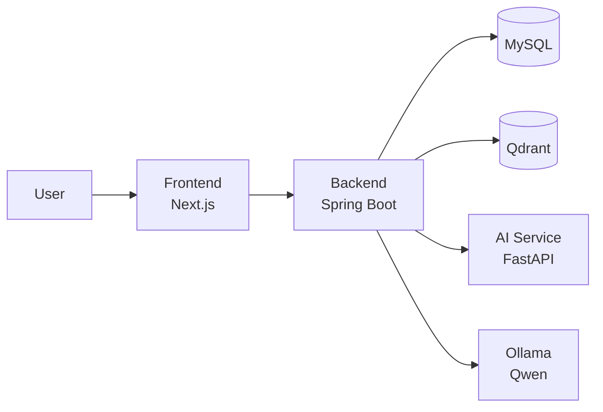

<div align="center">

# 🎬 WhatToWatch

### Intelligent Movie Recommendation and Discovery

_Vector Search · Hybrid Search · Reranking · AI Chatbot_

[Features](#-features) · [Architecture](#-architecture) · [Tech Stack](#-tech-stack) · [Data Sources](#-data-sources) · [Getting Started](#-getting-started)

</div>

---

WhatToWatch is a movie discovery web application inspired by Netflix. Users can search for movies in natural language, receive personalized recommendations, and ask a local AI assistant for suggestions. The catalog contains **46,923 movies**.

## ✨ Features

| Feature                          | Description                                                           |
| -------------------------------- | --------------------------------------------------------------------- |
| **Hybrid search**                | Dense and sparse vectors (BGE-M3), merged with Reciprocal Rank Fusion |
| **Reranking**                    | Candidates are re-scored with the `bge-reranker-v2-m3` cross-encoder  |
| **Personalized recommendations** | Based on ratings, favorites, watchlist, and watch history             |
| **Local AI chatbot**             | Qwen on Ollama, with data access only through validated tools         |
| **Trailers**                     | YouTube trailers embedded from TMDB video metadata                    |
| **Offline evaluation**           | MRR, NDCG@K, Recall@K, and Precision@K for each retrieval stage       |

## 🏗️ Architecture



> [!IMPORTANT]
> The backend contains all business logic. The AI service only creates embeddings and reranks results. The chatbot never accesses the databases directly.

## 🧰 Tech Stack

| Layer           | Technology                                  |
| --------------- | ------------------------------------------- |
| Frontend        | Next.js, React, TypeScript                  |
| Backend         | Java Spring Boot                            |
| Database        | MySQL 8                                     |
| Vector database | Qdrant                                      |
| AI service      | Python, FastAPI, BGE-M3, bge-reranker-v2-m3 |
| Local LLM       | Qwen via Ollama                             |
| Data sources    | IMDb, TMDB, MovieLens                       |
| Deployment      | Docker Compose                              |

## 📚 Data Sources

| Source                                                                              | Used for                                                   |
| ----------------------------------------------------------------------------------- | ---------------------------------------------------------- |
| [IMDb Non-Commercial Datasets](https://developer.imdb.com/non-commercial-datasets/) | Movie catalog: titles, genres, ratings, and crew           |
| [TMDB API](https://www.themoviedb.org/documentation/api)                            | Posters, overviews, keywords, cast, and trailers           |
| [MovieLens](https://grouplens.org/datasets/movielens/)                              | Offline evaluation of retrieval and recommendation quality |

The catalog data is stored in `data/mysql/movies_data.sql`. This file is provided separately by the team.

> This product uses the TMDB API but is not endorsed or certified by TMDB. IMDb data is used for non-commercial, educational purposes only.

## 🚀 Getting Started

**Requirements:** Docker with Compose, and the data file `data/mysql/movies_data.sql` (provided separately by the team).

**1. Clone the repository**

```bash
git clone https://github.com/Khanhlc2005/WhatToWatch.git
cd WhatToWatch
```

**2. Create the environment file**

```bash
cp .env.example .env
```

**3. Start the core services**

```bash
docker compose up -d --build mysql backend frontend
```

**4. Open the application**

| Service     | URL                                          |
| ----------- | -------------------------------------------- |
| Web app     | <http://localhost:3000/browse>               |
| Backend API | <http://localhost:8080/movie-recommendation> |

> [!NOTE]
> The browse page does not need the AI service or Qdrant. To enable semantic search and the chatbot, run `docker compose up -d` to start all services.

> [!WARNING]
> Do not run `docker compose down -v` without a backup. It deletes the data volumes.

## 📁 Project Structure

```text
├── ai-service/   FastAPI service for embeddings and reranking
├── backend/      Spring Boot API and business logic
├── frontend/     Next.js web application
├── qdrant/       Qdrant configuration and schema
├── data/         Database dump and processed data
├── docs/         Project documentation
└── notebooks/    Experiments and evaluation
```
